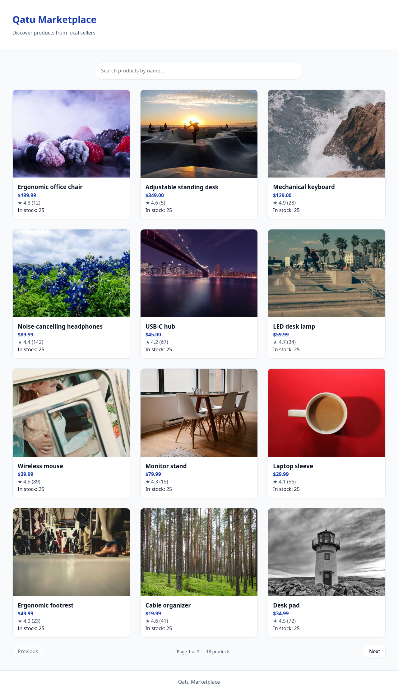
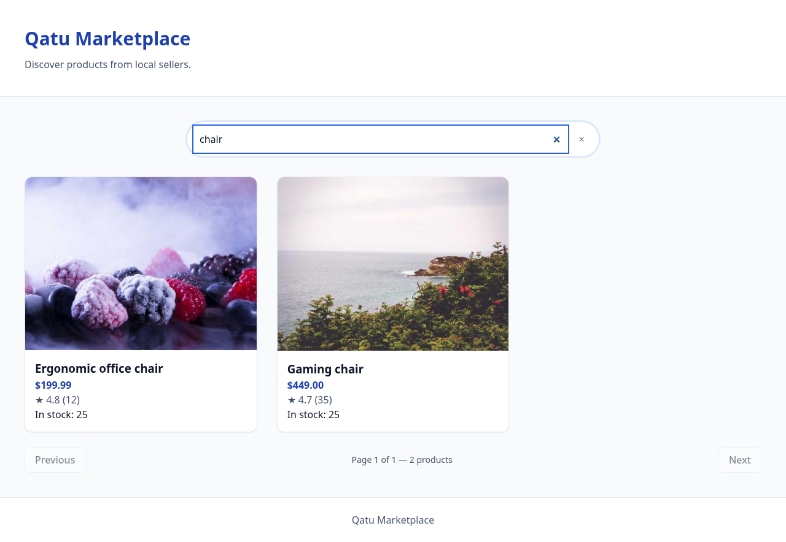
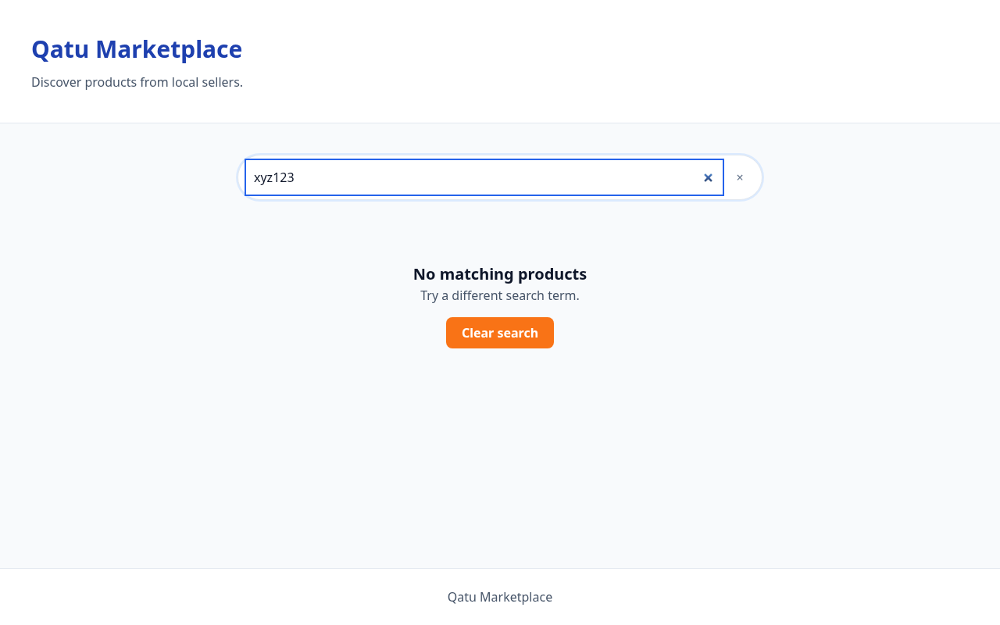
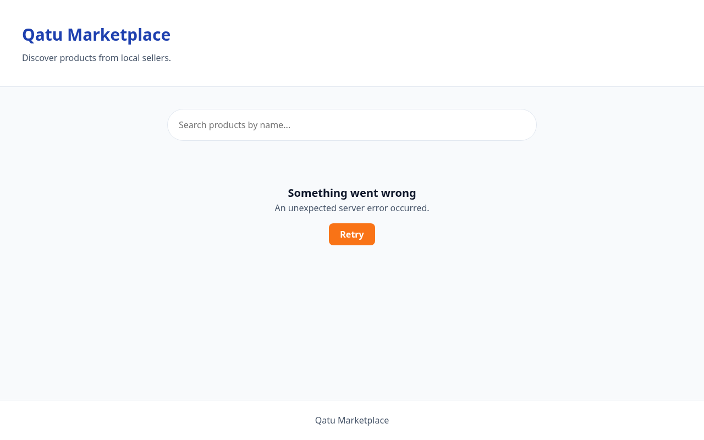
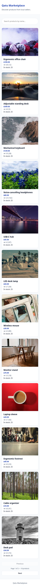
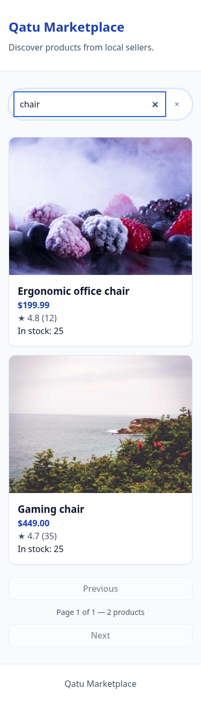
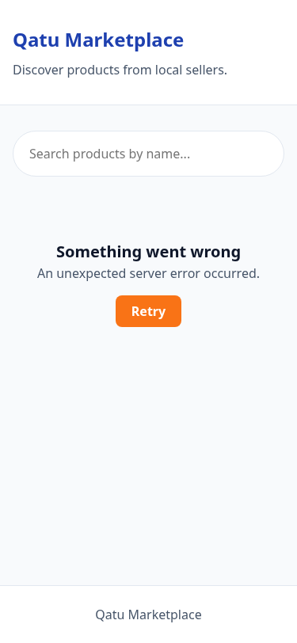
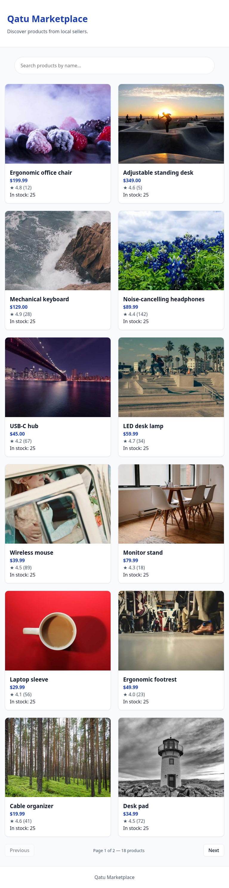

# Laboratorio Semana 6 — Actividad #2: Front-End para Búsqueda y Paginación de Productos

| Metadato                    | Detalle                                                                                                                                             |
| --------------------------- | --------------------------------------------------------------------------------------------------------------------------------------------------- |
| Estudiante                  | Diego Alejandro Botina                                                                                                                              |
| Curso                       | CSSD-245 — Software Development 4                                                                                                                   |
| Universidad                 | Jala University                                                                                                                                     |
| Semana                      | 6                                                                                                                                                   |
| Actividad                   | #2                                                                                                                                                  |
| Fecha de entrega            | 7 de noviembre de 2026                                                                                                                              |
| Repositorio GitLab          | https://gitlab.com/cohort-5/ES.CSSD-245.GA.T2.26.M2/SD/group-b/individual-laboratories/alejandro-botina/week-06/jala-cssd-245-qatu-catalog-frontend |
| Repositorio GitHub (mirror) | https://github.com/JalaU-Labs/jala-cssd-245-qatu-catalog-frontend                                                                                   |
| Licencia                    | MIT                                                                                                                                                 |

## 1. Introducción

El laboratorio de la Semana 6 planteó la construcción de una interfaz para el catálogo de Qatu Marketplace y permitió elegir al menos una de las alternativas de funcionalidad propuestas. Se implementaron búsqueda de productos y paginación por páginas, integradas con una API REST para que el servidor procese los criterios de búsqueda y el conjunto de resultados. Se eligieron ambas funciones porque resuelven tareas complementarias: encontrar productos por nombre y recorrer catálogos que exceden el tamaño de una página. La interfaz incluye estados de carga, ausencia de resultados y error, además de una presentación adaptable a distintos tamaños de pantalla.

## 2. Objetivos

- Implementar búsqueda de productos procesada por el servidor y navegación paginada mediante controles Previous y Next.
- Presentar los resultados con una interfaz responsiva que comunique los estados de carga, vacío y error, e incluya una acción para reintentar solicitudes fallidas.

## 3. Decisiones de arquitectura

### 3.1 Tecnologías

La aplicación utiliza HTML5, CSS3 y JavaScript ES2022+, sin un framework de interfaz. Los tipos se documentan mediante JSDoc y se verifican con TypeScript en modo `--checkJs`, manteniendo el código de ejecución en archivos JavaScript.

### 3.2 Búsqueda procesada por el servidor

La búsqueda se envía al backend como el parámetro `search`. No se filtra la página actual en el cliente, porque la API pagina el conjunto completo de resultados. Filtrar localmente una sola página podría ocultar coincidencias de otras páginas y producir resultados inconsistentes.

### 3.3 Paginación

Las solicitudes usan los parámetros `page` y `limit`, con un tamaño de página de 12 productos. Cada nueva búsqueda vuelve a `page=1` para evitar que una consulta diferente herede un número de página que no exista en sus resultados.

### 3.4 Debounce

El campo de búsqueda aplica un debounce de 500 ms. Esto agrupa la escritura rápida en una sola búsqueda y reduce solicitudes innecesarias al backend.

### 3.5 Estados de la interfaz

El estado `loading` presenta tarjetas skeleton; `success` muestra los productos y la paginación; una respuesta sin coincidencias presenta un estado `empty`; y los errores muestran un mensaje con la acción Retry.

### 3.6 Accesibilidad

La interfaz emplea HTML semántico, regiones `aria-live`, controles operables mediante teclado y estilos visibles de foco. Estas decisiones siguen prácticas alineadas con WCAG 2.1 AA; no constituyen una certificación formal de conformidad.

## 4. Capturas de pantalla

Vista inicial del catálogo en escritorio, con la primera página de productos.



Resultados de búsqueda para productos relacionados con sillas.



Estado vacío al buscar un término sin coincidencias.



Segunda página del catálogo en una ventana de escritorio.


Estado de error de la API en la vista de escritorio.



Vista inicial adaptada a una pantalla móvil.



Resultados de búsqueda en el diseño móvil.



Estado de error presentado en una pantalla móvil.



Vista inicial del catálogo en una pantalla de tableta.



## 5. Casos de prueba

### 5.1 Pruebas unitarias e integración (Vitest)

La suite contiene 107 pruebas en 13 archivos de prueba, organizadas en cinco grupos principales: utilidades, API, componentes, store de catálogo y composición de la aplicación. Las pruebas verifican validaciones, transiciones de estado, interacciones de componentes y resultados de solicitudes simuladas.

### 5.2 Pruebas end-to-end (Playwright)

La suite contiene 16 pruebas agrupadas en cinco archivos: arranque de la aplicación (smoke), búsqueda, paginación, estados de error y diseño responsivo. Las solicitudes a `/v1/products` se interceptan con `page.route()` y respuestas de prueba deterministas, por lo que la suite no depende de la disponibilidad del backend.

## 6. Cómo reproducir el proyecto

```bash
pnpm install
pnpm dev              # desarrollo en http://localhost:5173
pnpm build            # build estático
pnpm preview          # servir el build en http://localhost:4173
pnpm test             # tests unitarios (Vitest)
pnpm test:e2e         # tests E2E (Playwright)
pnpm lint && pnpm format:check && pnpm typecheck
pnpm screenshots      # regenerar las capturas
```

## 7. Containerización

El `Dockerfile` utiliza dos etapas: Node 22 compila la aplicación y Nginx sirve los archivos estáticos resultantes. La imagen define un health check en `/healthz`. Para iniciar el servicio en `http://localhost:8080`, se ejecuta `docker compose up -d`. El argumento de build `VITE_API_BASE_URL` se inyecta durante la compilación, ya que Vite incorpora ese valor en el bundle.

## 8. Integración continua

Se configurarán dos pipelines equivalentes en el repositorio: uno para GitHub Actions y otro para GitLab CI. Ambos ejecutarán lint, format:check, typecheck, pruebas y build para comprobar los cambios en las dos plataformas.

## 9. Repositorio y commits

- GitLab (principal): https://gitlab.com/cohort-5/ES.CSSD-245.GA.T2.26.M2/SD/group-b/individual-laboratories/alejandro-botina/week-06/jala-cssd-245-qatu-catalog-frontend
- GitHub (mirror): https://github.com/JalaU-Labs/jala-cssd-245-qatu-catalog-frontend

| Hito                       | Commit                                                           |
| -------------------------- | ---------------------------------------------------------------- |
| Scaffold                   | <!-- COMMIT_HASH --> <!-- PENDIENTE: completar con hash real --> |
| Toolchain                  | <!-- COMMIT_HASH --> <!-- PENDIENTE: completar con hash real --> |
| Infraestructura de pruebas | <!-- COMMIT_HASH --> <!-- PENDIENTE: completar con hash real --> |
| Dominio y HTTP             | <!-- COMMIT_HASH --> <!-- PENDIENTE: completar con hash real --> |
| Componentes de interfaz    | <!-- COMMIT_HASH --> <!-- PENDIENTE: completar con hash real --> |
| Orquestador                | <!-- COMMIT_HASH --> <!-- PENDIENTE: completar con hash real --> |
| E2E                        | <!-- COMMIT_HASH --> <!-- PENDIENTE: completar con hash real --> |
| Containerización           | <!-- COMMIT_HASH --> <!-- PENDIENTE: completar con hash real --> |

## 10. Conclusiones

Separar el dominio y la comunicación HTTP de la interfaz permitió probar reglas de búsqueda y paginación sin acoplarlas al DOM. El enfoque de desarrollo guiado por pruebas ayudó a precisar transiciones de estado, cancelación de solicitudes y comportamiento de los controles. Los mocks de Playwright hicieron posible comprobar flujos completos de forma repetible sin depender del backend ni de sus datos disponibles. La containerización añadió una forma reproducible de servir el build estático y verificar la disponibilidad mediante un health check. El trabajo integró decisiones de accesibilidad y diseño responsivo desde la composición de la interfaz, no como elementos aislados.
